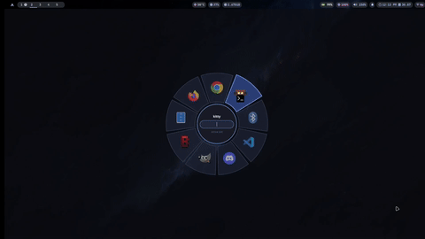

radiq is a Wayland-native radial application launcher inspired by weapon wheels in games. You pin your favourite apps to a pie-slice wheel, or type to fuzzy-search everything installed.

**Links:** [GitHub](https://github.com/israrkhan-cys/radiq) · [AUR](https://aur.archlinux.org/packages/radiq)

<!-- Add the demo GIF next to this file as demo.gif -->



## Install

```bash
yay -S radiq
# or
paru -S radiq
```

## Features

- Pie-slice wedge wheel UI
- Centered fuzzy search
- JSON config for pinned apps, colors, radius, animation and scrim transparency
- Real icon discovery from `.desktop` files
- Launches apps through `hyprctl`

## Stack

Qt 6, QML, C++20, LayerShellQt (Wayland layer-shell overlay), packaged for the AUR.

## What I've fixed since v0.1.0

- **Firefox default override bug**, reported through a GitHub issue.
- **Launching broke after Hyprland moved its config from `hyprland.conf` to `hyprland.lua`.** `hyprctl dispatch` started evaluating the `exec` command as a Lua expression, so unquoted commands threw errors and `--` was parsed as a Lua comment. I traced it to `AppCatalogModel::launchExec()` and made it support both config formats. This shipped in v0.1.1.
- Several smaller bug fixes, released as v0.1.1 on the AUR.

## Known limitations and roadmap

- Hyprland only for now, since launching goes through `hyprctl`. Other wlroots compositors are untested.
- Newly installed apps appear after restarting the daemon, because the catalog is only loaded at startup. A filesystem watcher is planned. 
- Next feature: usage-frequency tracking, with a hybrid pinned and frequently-used wheel.