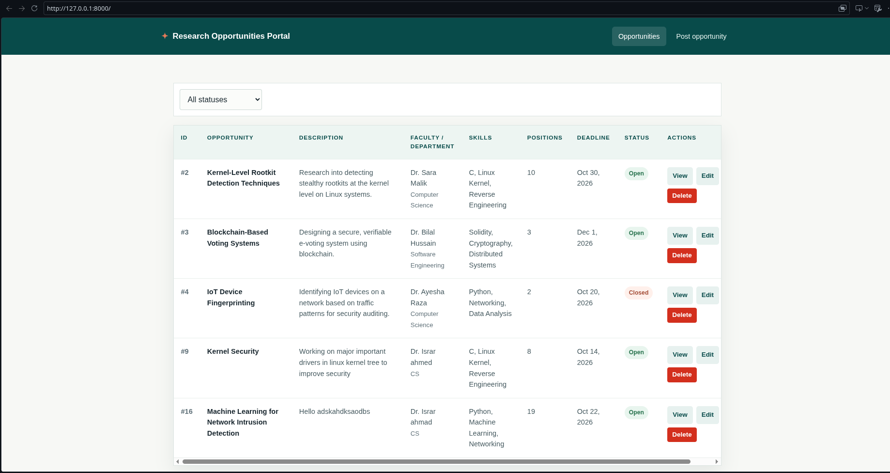

A web application where faculty members can post, view, update and manage research opportunities in one place, replacing scattered emails, WhatsApp groups and noticeboards. I built it for a Computer Networks assignment: a REST API backend, a MySQL/MariaDB database and a simple frontend.

**Repo:** [github.com/israrkhan-cys/research-opportunity-portal](https://github.com/israrkhan-cys/research-opportunity-portal)




## Features

- Full CRUD REST API for research opportunities
- Input validation on the backend (Pydantic) and the frontend (required form fields)
- Proper HTTP status codes: 200, 201, 400, 404 and 500
- Frontend that talks to the API through `fetch()`, with no hard-coded data
- Create, edit, delete and view opportunities, and change status from Open to Closed

## Stack

| Layer | Technology |
|---|---|
| Backend | Python, FastAPI, Uvicorn |
| ORM | SQLAlchemy with the PyMySQL driver |
| Database | MySQL / MariaDB |
| Frontend | HTML, CSS, JavaScript (served by FastAPI) |
| Testing | Postman / Bruno collection (included in the repo) |

The frontend is served by the same FastAPI app, so no separate frontend server is needed. Database credentials are loaded from a `.env` file that is excluded from version control.

## Project structure

```
research-opportunity-portal/
├── backend/
│   ├── app.py               # FastAPI app and route definitions
│   ├── database.py          # Engine, session, and get_db dependency
│   ├── database_model.py    # SQLAlchemy model (table definition)
│   ├── models.py            # Pydantic models (request validation)
│   └── database_schema.sql  # Table creation and sample data
├── frontend/
│   ├── index.html           # List all opportunities
│   ├── create.html          # Create / edit form
│   ├── view.html            # Single opportunity details
│   ├── app.js
│   └── style.css
└── postman/                 # Exported API collection
```

## Data model

A single table, `research_opportunities`, because the assignment treats the faculty member's name as a plain field on the opportunity and not a separate entity.

| Column | Type | Notes |
|---|---|---|
| id | INT, PK, AUTO_INCREMENT | Unique ID |
| research_title | VARCHAR(255) | |
| research_description | TEXT | |
| research_area | VARCHAR(255) | |
| faculty_name | VARCHAR(255) | |
| department | VARCHAR(255) | |
| required_skills | VARCHAR(255) | Comma-separated list |
| available_positions | INT | |
| application_deadline | DATE | YYYY-MM-DD |
| status | ENUM('Open','Closed') | Defaults to Open |

## API

Base path: `/api/opportunities`

| Method | Endpoint | Description | Success |
|---|---|---|---|
| POST | `/api/opportunities` | Create a research opportunity | 201 |
| GET | `/api/opportunities` | Retrieve all opportunities | 200 |
| GET | `/api/opportunities/{id}` | Retrieve one opportunity by ID | 200 |
| PUT | `/api/opportunities/{id}` | Update an existing opportunity | 200 |
| DELETE | `/api/opportunities/{id}` | Delete an opportunity | 200 |

Invalid or missing input returns `400`, an unknown ID returns `404`, and unexpected failures return `500`. FastAPI also generates interactive Swagger docs at `/docs`.

## Testing

The repo includes a Postman collection (it also imports into Bruno). It covers:

- Creating at least three opportunities
- Retrieving all opportunities, and one by ID
- Updating an opportunity and changing its status from Open to Closed
- Deleting an opportunity, then requesting it again to confirm the `404`
- Sending invalid or missing data to check input validation

## Run it locally

You need Python 3.10+ and a local MySQL or MariaDB server.

```bash
git clone https://github.com/israrkhan-cys/research-opportunity-portal.git
cd research-opportunity-portal
python -m venv .venv && source .venv/bin/activate
pip install -r requirements.txt
# create the database, load backend/database_schema.sql, add backend/.env
uvicorn backend.app:app --reload
```

The full setup steps, including the `.env` variables, are in the [README](https://github.com/israrkhan-cys/research-opportunity-portal#readme).

